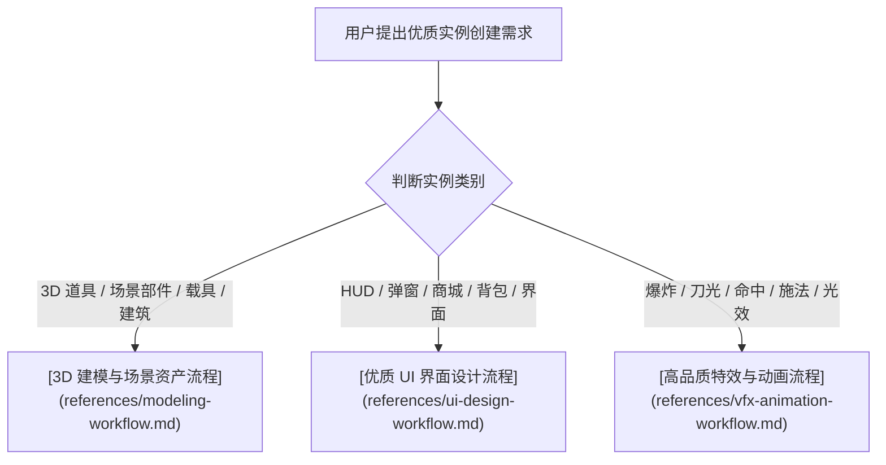

# 优质实例创建流程 (Quality Instance Workflow)

本 Skill 是面向 Roblox 游戏开发的高品质资产与实例创建标准流程。
当且仅当**用户明确提出需要创建优质实例、高质量资产或精细化表现**时触发本流程。

---

## 一、核心原则与工程红线

1. **拒绝粗糙占位**：严禁直接用单 Part 灰模、未调参的默认粒子或简陋无布局的 UI 作为最终交付。
2. **实例唯一来源原则**：
   - 持久化 UI 模板和 3D 模型必须在 **Studio Edit 模式** 下创建并归档至规范目录（如 `ReplicatedStorage.UI`、`ReplicatedStorage.Models`）。
   - 运行时代码仅负责克隆模板、数据绑定、生命周期驱动与状态同步，禁止在运行期通过代码裸写 `Instance.new` 拼装复杂界面或模型。
3. **尊重现有同步链路**：沿用已建立的本地文件与 Script Sync 同步，不在 MCP 中随意覆写业务脚本源码，不在 Edit 模式下非法 `require` 业务代码。
4. **闭环交付与实机验收**：所有优质实例创建完成后，必须通过只读属性核验、视口截图或 Play 模式对象池采样验收。

---

## 二、任务路由与流程索引

根据用户提出的优质实例具体类别，**按需加载** 对应的详细流程规范：

- **3D 道具、模型、场景组件与刚性预制体**：
  👉 读取并严格执行 [3D 建模与场景资产流程](references/modeling-workflow.md)。
- **界面、HUD、弹窗、面板、图标与自适应 UI**：
  👉 读取并严格执行 [优质 UI 界面设计流程](references/ui-design-workflow.md)。
- **粒子特效、Mesh VFX、Flipbook 序列帧、受击震颤与对象池**：
  👉 读取并严格执行 [高品质特效与动画流程](references/vfx-animation-workflow.md)。

---

## 三、标准交付检查清单 (Delivery Checklist)

每个优质实例交付前必须逐一核对以下检查点：

- [ ] **视觉与比例达标**：符合真实角色比例（Player ~5 studs），材质与配色和谐，无拉伸畸变；
- [ ] **物理与装配规范**：挂接物 `CanCollide=false`、`Massless=true`；根节点为 `PrimaryPart`，Weld 约束完整；
- [ ] **UI 适配完整**：包含 `UIScale`，支持 1920×1080 基准，严格避让 `DeviceSafeInsets`；
- [ ] **特效零泄漏与对象池**：频繁特效已接入 Warmup 预热池，无运行期持续累积的内存或实例泄漏；
- [ ] **资产合法性确认**：外部贴图与网格已通过 Open Cloud 正式上云获取 `rbxassetid://`，无临时死链。
