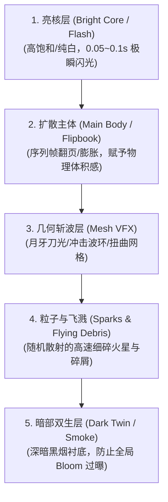

# 高品质特效与动画流程 (Quality VFX & Animation Workflow)

本流程整合 Roqer 的专业 Roblox 特效分层设计理念与工程级性能优化实践，用于构建具备强烈视觉打击感、多层发光质感且无内存泄漏的工业级特效。

---

## 一、特效设计黄金四层法则 (Layering & Hierarchy)

严禁直接使用单个缩放的 ParticleEmitter 作为特效！优质特效必须由 **多层次组件协同叠加** 构成：

1. **亮核层（Bright Core / Flash）**：
   - 作用：提供瞬间的受击或爆炸点，触发第一时间的视觉响应；
   - 参数：纯白或高饱和荧光色，生命周期极短（0.05~0.12s），瞬时膨胀后迅速隐去。
2. **扩散主体层（Main Body / Flipbook）**：
   - 作用：表现爆炸烟团、火焰涡流或魔法阵的体积扩张过程；
   - 制作：采用 8×8（64 帧）或 4×4（16 帧）的高质量序列帧（Flipbook），结合 `ParticleEmitter.FlipbookLayout` 播放，禁止单图拉伸。
3. **几何斩波层（Mesh VFX）**：
   - 作用：强力攻击、挥砍、冲击波必须具备明确的流线几何形体；
   - 制作：在 Blender 中制作弯刀月牙（Crescent）、环形冲击波（Shockwave Ring）、扭曲漩涡（Tornado/Swirl）；
   - 驱动：利用 `TweenService` 对 `MeshPart` 的 `Size` 与 `Transparency` 进行平滑缓动（0.2~0.4s Quad/Expo 曲线扩散）。
4. **粒子飞溅层（Sparks & Debris）**：
   - 作用：飞溅火星、受击残渣或魔法火花，赋予画面动态张力；
   - 驱动：使用带有 `SpreadAngle`、`Drag`、`Acceleration` 的点爆发粒子。
5. **暗部双生层（Dark Twin / Smoke）**：
   - 作用：**Roblox 工业级特效的关键秘诀**。纯亮特效极易被场景的全局 Bloom（泛光）吞成一片刺眼的纯白；
   - 处理：在亮核周围铺设一层较暗的焦黑烟雾（Dark Smoke），利用高对比度反衬内部高光，使特效在白昼与黑夜均层次分明。

---

## 二、本地极速预览工作流 (Local Preview Pipeline)

为避免调试特效贴图时频繁上传审核带来的延迟与网络垃圾：

1. **本地纹理直读机制**：
   - 将生成的序列帧 PNG 输出到本地 Roblox Studio 目录（`%LOCALAPPDATA%\Roblox\Versions\<version>\content\textures\roqer-preview`）；
   - 在 Studio 中的粒子发射器直接填入 `rbxasset://textures/roqer-preview/<filename>.png`；
   - 毫秒级即时加载，免审核，随时修改随时生效。
2. **定稿上云替换**：
   - 当特效参数与画面完全调校满意后，调用 Open Cloud 批量上传贴图为 Decal；
   - 最终自动将 `rbxasset://` 替换为合法的 `rbxassetid://`。

---

## 三、屏幕冲击与环境反馈 (Camera & World Feedback)

一个优质的特效不仅发生在世界中，更应该让玩家直接感知冲击力：

1. **镜头震颤（Camera Shake）**：
   - 爆炸与重击时，根据玩家距离衰减施加 0.1~0.3s 的高频小幅度镜头偏移（使用噪声函数或回弹弹簧驱动）。
2. **视场冲击（FOV Shock）**：
   - 在爆发瞬间 FOV 迅速收缩或微量拉大 3~5°，随后在 0.2s 内弹性复原。
3. **黑白/反色冲击帧（Impact Frames）**：
   - 顶级打击感技法：在命中瞬间切入 1~2 帧的高对比黑白/负片全屏极简闪烁。
4. **世界动态残留**：
   - 地面投射焦黑弹坑/裂缝贴图（Decal / Texture，带淡出计时）；
   - 爆发中心瞬间激活高强度点光源（`PointLight`），并在 0.1s 内指数衰减关闭。

---

## 四、工程落地：对象池预热与零 GC (Vfx Pool Integration)

在高频对战或多人游戏中，频繁 `Instance.new` / `Clone` 与 `Debris:AddItem` 销毁会导致灾难性的帧率抖动与内存碎片：

1. **关卡预热对象池（Warmup Pool）**：
   - 在关卡或场景加载期（Preload 阶段），提前实例化 20~40 个预制特效槽位（Slots）；
   - 所有槽位中的 `ParticleEmitter` 设置为 `Rate = 0`，实例设置 `CanCollide = false`、`CastShadow = false` 并放置在不可见的隐藏容器中。
2. **发射与回收闭环（Emit & Reset）**：
   - 播放时直接从池中取出空闲槽位，移动至目标位置；
   - 调用 `:Emit(count)` 激发粒子，利用 `TweenService` 播放几何扩散；
   - 统一由 Heartbeat 或定时器推进；
   - 表现结束后，重置全部透明度与缩放参数，重新放回空闲池，**严禁使用 `Debris:AddItem` 或销毁实例**。
3. **MicroProfiler 性能验收**：
   - 连续触发高并发特效压力测试（例如同屏触发 20 次重度爆炸）；
   - 检查客户端帧耗时（Heartbeat 中位帧率保持在 16.6ms 内）；
   - 确认无未回收的粒子发射器或失控的 RenderStepped 监听。
