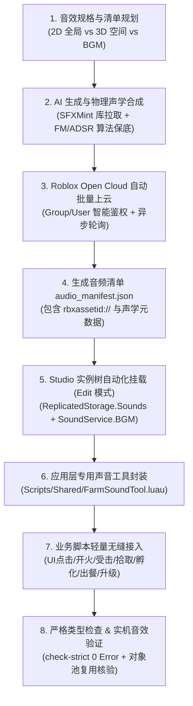

# Roblox 音频资产全流程开发工作流 (Roblox Audio Workflow)

本 Skill 是面向 Roblox 游戏开发的标准化音频工程流程。涵盖：
1. **音效清单声学规格设计**；
2. **AI 音频拉取与物理声学高保真合成管线**；
3. **Roblox Open Cloud 批量自动上云与资产清单维护**；
4. **Roblox Studio 实例树标准化部署（`ReplicatedStorage.Sounds` 与 `SoundService.BGM`）**；
5. **架构分层红线、项目专用声音工具与双重对象池业务接入**。

---

## 一、核心原则与工程红线

1. **底层 Core 零侵入原则**：
   - **严禁修改通用底层框架代码（如 `Core/` 目录）**！
   - 项目专属的声音逻辑、业务播放映射与音效工具必须置于应用层（例如 `Scripts/ReplicatedStorage/Scripts/Shared/FarmSoundTool.luau`）。
2. **实例唯一来源原则 (Single Source of Truth)**：
   - **BGM 实例**：仅背景音乐（Loop 属性）放置于 `SoundService.BGM`。
   - **除 BGM 外的所有 SFX 音效**：必须且只能在 Studio Edit 模式下统一预置在 `ReplicatedStorage.Sounds`（Folder）中，作为全工程音效模板的唯一来源。
   - 禁止在运行期用裸代码 `Instance.new("Sound")` 动态拼装资产 ID 或硬编码第二套配置。
3. **严苛的脚本规范**：
   - 所有新增与维护的 Luau 音效脚本，**第 1 行必须为中文业务注释**，**第 2 行必须为 `--!strict` 严格模式**。
   - 必须通过 `luau-lsp analyze` 静态检测（0 Error）。
4. **性能与内存安全（双重对象池）**：
   - 禁止每次播放都克隆新 Sound 且不回收；
   - 必须实现局部空间音效 `Attachment` 缓存池与 `Sound` 克隆对象池，监听 `Ended`/`Stopped` 自动回收复用。
5. **官方云端合规性与权限适配**：
   - 所有上传资产必须属于合规 CC0/授权范围；
   - Open Cloud 上传必须精准识别目标 Place 的归属者（User 还是 Group），杜绝 403 权限拒绝；轮询必须带 `assets/v1` 路由。

---

## 二、全流程架构全景图



---

## 三、各阶段标准作业规范 (SOP)

### 阶段一：音效规格设计与声学规划
- **2D 全局音效**：UI 点击（`UIClick`）、弹窗开关（`UIOpen`/`UIClose`）、货币结算（`Coin`）、警告（`Warning`）。此类音效不依赖空间位置，直接在 `SoundService` 或本地播放。
- **3D 局部空间音效**：武器开火（`Zap_T1~T5`）、物理碰撞（`EggLand`/`FoodDrop`）、生物交互（`EggHatch`/`AnimalHit`/`AnimalScared`）。此类音效需挂载于空间 `Attachment`，受距离衰减（RollOff）控制。
- **循环背景音乐 (BGM)**：欢快、无缝循环（Loop）、采样率 44.1kHz、-14 LUFS 响度。
- 👉 详见参考文档：[音效设计与声学合成规范](references/audio-generation.md)。

### 阶段二：AI 生成与物理声学合成管线
- **首选源**：采用 SFXMint（`https://github.com/sfxmint/sfxmint-mcp` 或 REST 接口）按关键词拉取高品质 CC0 音效。
- **保底与精确合成**：当 API 受限（如未鉴权 IP 限流 429）或需精确阶位过渡（如 T1~T5 激光频率递增）时，使用 Python `numpy` + `lameenc` 物理声学引擎算法生成：
  - **FM 调频合成**：生成激光脉冲、电弧放电、能量充能；
  - **谐波衰减合成**：生成清脆硬币叮当、金属轻敲、木盒闭合；
  - **带通滤波噪声**：生成动物电熟滋滋声、气流呼啸；
  - **ADSR 振幅包络**：严谨设置 Attack（1~5ms 起振）与 Release（消除音频头尾 Pop/Click 爆音）。
- 输出规范：统一保存至 `Assets/Sounds/<SoundName>.mp3`。

### 阶段三：Roblox Open Cloud 自动批量上云
- **自动化工具**：`Tools/Audio/upload_roblox_audio.py`。
- **环境变量**：`SIXCUBE_ROBLOX_OPENCLOUD_KEY`。
- **避坑与权限原则**：
  - 如果 Place 属于 Group（例如 Group `33977495`），请求体必须配置 `"creator": {"groupId": "<id>"}`；若配置为 `userId` 则必报 403。
  - 上传接口：`POST https://apis.roblox.com/assets/v1/assets`（multipart/form-data）。
  - 轮询接口：`GET https://apis.roblox.com/assets/v1/operations/{operationId}`（必须带 `assets/v1/`）。
- **资产清单持久化**：成功后生成/更新 `Assets/Sounds/audio_manifest.json`，支持增量跳过。
- 👉 详见参考文档：[Open Cloud 批量上云实战踩坑与配置](references/opencloud-upload.md)。

### 阶段四：Studio 实例树自动化挂载
- **挂载位置要求**：
  - `game.SoundService.BGM`（Sound 实例，`Looped = true`，音量 ~0.4）；
  - `game.ReplicatedStorage.Sounds`（Folder 实例，内含全部 22 个 SFX `Sound` 模板，`Looped = false`）。
- **自动化工具**：`Tools/Audio/setup_sounds_in_studio.py`。
- **执行方式**：在 Studio **Edit 模式** 下，通过 `fast_connect` (StudioMCP) 运行部署脚本，自动比对创建或更新，确保幂等。
- 👉 详见参考文档：[Studio 实例部署与 MCP 挂载指南](references/studio-deployment.md)。

### 阶段五：架构分层与运行时业务接入
- **架构红线**：禁止修改 `Core/`，新建 `Scripts/ReplicatedStorage/Scripts/Shared/FarmSoundTool.luau`。
- **提供统一接口**：
  ```luau
  -- 2D/3D 自动路由播放
  FarmSoundTool.Play(soundName: string, position: Vector3?, volumeMultiplier: number?): Sound?
  -- 背景音乐控制
  FarmSoundTool.PlayBGM(bgmInstanceOrName: (Sound | string)?): Sound?
  FarmSoundTool.StopBGM(bgmInstanceOrName: (Sound | string)?)
  FarmSoundTool.SetBGMVolume(volume: number)
  FarmSoundTool.SetSoundEffectVolume(volume: number)
  ```
- **双重对象池原理**：
  1. `localSoundAttachmentsPool: { Attachment }`：复用挂载在 workspace 隐藏载体 Part 上的 Attachment，避免高频创建销毁；
  2. `soundsPools: { [Sound]: { Sound } }`：按音效模板维护 Sound 实例池，播放完毕（`Ended`/`Stopped`）后清空 Parent 并回池；模板销毁时自动清理。
- 👉 详见参考文档：[音频运行时架构、对象池与业务接入规范](references/audio-runtime-architecture.md)。

---

## 四、标准交付检查清单 (Delivery Checklist)

完成音频全流程后，必须逐条核对：

- [ ] **底层框架未受污染**：`git status -s Scripts/ReplicatedStorage/Core` 无任何修改；
- [ ] **实例唯一来源满足**：除 `SoundService.BGM` 外，全部音效模板唯一存在于 `ReplicatedStorage.Sounds`（Folder）中；
- [ ] **Open Cloud 官方资产可达**：所有实例的 `SoundId` 均为有效的 `rbxassetid://...`，零死链；
- [ ] **严格类型检查通过**：修改与新增的所有 Luau 脚本，首行包含中文注释，第 2 行为 `--!strict`，经 `pwsh Tools/check-strict.ps1` 校验为 **0 Error**；
- [ ] **无内存与实例泄漏**：空间音效和克隆 Sound 在播放完毕后能正常回池，无挂滞在 workspace 的游离 Attachment 或未回收 Sound。
