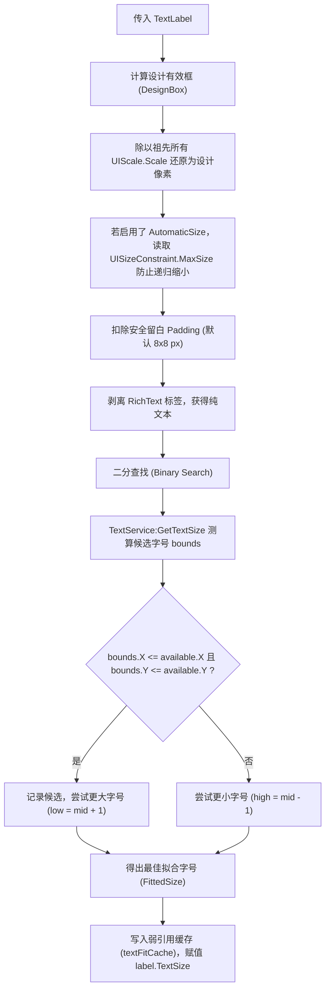

# 单行文本二分拟合算法与 UIStroke 描边自适应规范

本规范深入解析 Roblox 原生文字缩放与描边体系的缺陷，并提供工业级二分查找单行文本拟合算法与 `UIStroke` 原生自适应标准。

---

## 一、为什么屏幕单行文本禁用 TextScaled？

Roblox 原生属性 `TextScaled = true` 在 3D 标牌或全屏单一标语中表现尚可，但在**复杂的屏幕 UI 与数据看板中是典型反模式**：

1. **短文案异常暴增**：若文本框宽度为 200px，当数字为 `1` 时，`TextScaled` 会将其暴力拉大到充满整个文本框，导致界面失调；
2. **多行与并列文字字号参差不齐**：同类卡片中文本长度稍有不同，`TextScaled` 就会计算出完全不同的字号，破坏排版对齐；
3. **模糊抖动**：频繁赋值时，引擎动态栅格化缩放可能引发微小的像素抖动。

---

## 二、二分查找单行文本拟合算法 (FitTextLabel)

### 1. 核心思想与契约
- **屏幕单行文本一律设置**：
  - `TextScaled = false`
  - `TextWrapped = false`
- **设计字号上限**：
  - 模板中设置 Attribute `DesignTextSize = <基准字号>`（如 36）。
- **只缩不放原则**：
  - 短文案保持 `DesignTextSize`，文字清晰锐利、高度一致；
  - 超长文案在设计框内**二分查找**能够完整容纳整行文字的最大字号；
  - 无论屏幕多宽，单行文本字号永远不超过 `DesignTextSize`，下限不低于 `minSize`（默认 1）。

### 2. 算法核心步骤与边界换算



### 3. 核心边界与踩坑点防护
1. **自动变宽控件（AutomaticSize）的恶性循环防护**：
   - 若文本设置了 `AutomaticSize.X`，每次文本变长后，如果直接读取 `label.AbsoluteSize.X` 作为可用宽度，在下一次文字缩小时，文本框随之变窄，导致下一次二分测算可用空间进一步缩小，形成“越算越小、文字被吞”的死循环。
   - **解决方案**：为自动变宽的文本挂载 `UISizeConstraint`，并在算法中读取 `constraint.MaxSize.X` 作为硬性设计边界（`FitLimit`）。
2. **富文本（RichText）剥离**：
   - 带颜色或粗体标签（如 `<font color="#FF0000">100</font>`）的文本，若直接传给 `TextService:GetTextSize`，标签字符也会被当成物理文本参与测算。
   - **解决方案**：在测算前执行 `string.gsub(label.Text, "<[^>]->", "")`，过滤所有 XML 标签后再测量。
3. **弱引用零 GC 缓存**：
   - 使用 `setmetatable({}, { __mode = "k" })` 建立文本对象弱引用缓存表。
   - 缓存 `text`、`boxSize`、`font` 与 `designSize`。只有当文本内容、字体或容器尺寸发生实质变化时才调用 `TextService`，在 60 FPS 刷新下杜绝 CPU 开销与内存垃圾回收。

---

## 三、标准 UI 文本字号层级规范模板 (Standard Typography Hierarchy)

以当前实际 1920×1080 商业级 UI 模板为基准，提取出 **7 级标准字号层级体系**。所有新界面、弹窗、看板与列表项开发必须严格对标此层级模板，杜绝随意填入无规范的偶数/奇数字号：

| 层级 (Tier) | 设计字号 (`DesignTextSize`) | 典型控件尺寸 (宽×高 Offset) | 推荐字体 (`Font`) | 适用场景与实机典型组件 | 本地化契约 (`AutoLocalize`) | 实际拟合底线要求 |
| :--- | :---: | :---: | :--- | :--- | :---: | :--- |
| **T1: 英雄数值 (Hero Numbers)** | **`72`** | 220 × 104 | `GothamBold` | **核心资产余额大数字**<br>(如金币数 `1.25K`、积分大数) | `false` | 常用大数缩写实测达成率 100% (72 pt) |
| **T2: 终局结算与主数据** | **`56`** | 360 × 104 / 800 × 80 | `GothamBold` | **结算结果大标题、持物上限**<br>(如 `VICTORY`、`DEFEAT`、携带量 `0 / 10`) | `false` (数字) / `true` (文案) | `0 / 10` 等样本实测达成率 100% (56 pt) |
| **T3: 一级战况与核心属性** | **`44`** / **`36`** | 348 × 56 / 200 × 80 | `GothamBold` | **本队剩余重量、移速/负重属性、结算最终负载**<br>(如 `800 kg`、速度 `24`) | `false` (重量/属性) | 重量样本实测达成率 100% (44 pt) |
| **T4: 二级数据与价格** | **`32`** | 156 × 40 / 180 × 36 | `GothamBold` | **他队战况重量、升级卡价格、结算原因说明**<br>(如 `25 coins`、`OVERLOAD`) | `false` (价格) / `true` (说明) | 保持多队同屏字号完全统一 |
| **T5: 操作按钮与主通知** | **`28`** | 156 × 40 / 640 × 64 | `GothamBold` | **操作卡名称、升级标题、大厅引导、通用 Toast**<br>(如 `PICK UP`、`THROW`、`RUN FASTER`) | `true` | 全局高频交互，必须清晰锐利 |
| **T6: 状态指示与快捷键** | **`26`** / **`24`** / **`22`** | 148 × 28 / 32 × 36 | `GothamBold` | **危险报警、动作状态、PC 键位框、队名标签**<br>(如 `LOAD STABLE`、`E` 键、`TEAM A`) | `false` (状态/键位) / `true` (队名) | 与主按钮/卡片形成清晰的主次层级 |
| **T7: 辅助次级微提示** | **`20`** / **`9`** | 132 × 32 / 95 × 13 | `GothamBold` | **容量次级说明、瞄准操作微提示**<br>(如 `HOLD TO AIM`、`RELEASE TO THROW`) | `true` | 仅在辅助引导时出现，不得喧宾夺主 |
| **3D: 空间浮动标牌** | **`TextScaled = true`** | 随 3D 世界 Studs 缩放 | `GothamBold` / `FredokaOne` | **场景 3D 浮动标牌与大屏幕**<br>(垃圾堆牌、升级牌、引导牌、队伍立柱) | 动静分流 (数字 `false`) | 强制挂载 `ScaledSize` UIStroke (`Thickness=0.05`) |

### 文本框安全留白与 90% 拟合保证原则 (Fit Buffer Invariant)
1. **留白冗余扣除**：
   - 二分查找拟合算法默认会从文本框可用宽高各扣除 **`8 px` 内部安全留白 (`TextFitPadding = Vector2.new(8, 8)`)**；
   - **设计禁忌**：严禁仅提高 `DesignTextSize` 而不增加文本框高度。若设计字号为 72，文字框高度至少应给到 `100 ~ 104` px，否则文字因高度不足会被二分算法误判缩小；
2. **90% 拟合达成率标准**：
   - 常用业务样本（如金币数值 `99.9M`、携带数量 `10 / 10`、本队负载 `1000 kg`）在 1920×1080 桌面、手机横屏与平板预设下，**实际拟合计算得出的字号必须达到 `DesignTextSize` 的 90% 以上**；
3. **动静分流防污染铁律**：
   - 纯数字、动态拼装文案（`Hit +5coin`、`0 / 12`）、状态码、单字符（`E`、`▼`）**一律设置 `AutoLocalize = false`**；
   - 仅纯英文静态提示词设置 `AutoLocalize = true`。

---

## 四、阴影与双层立体字同步拟合 (FitTextWithShadow)

在优质 UI 中，常用一个半透明的 `ShadowText` 放在主文本下方偏移（如 `Position = {0, 2}, {0, 2}`）以实现立体投影质感。

- **问题**：若主文字缩小至 28 号，而未同步更新阴影层，阴影层保持 36 号，会导致严重的错位重影和裁切。
- **规范**：调用 `TextFitting.FitTextWithShadow(mainLabel, shadowLabel)`：
  ```luau
  local fittedSize = TextFitting.FitTextLabel(mainLabel)
  if shadowLabel then
      shadowLabel.TextScaled = false
      shadowLabel.TextWrapped = false
      shadowLabel.Text = mainLabel.Text
      shadowLabel.TextSize = fittedSize
  end
  ```
- 确保双层字形几何在任何长短文案下 100% 严丝合缝。

---

## 五、静态文本批量初始化 (FitMarkedRoot 与 FitMarkedText)

模板中常存在一些无需后续代码重复赋值的静态单行文本（如提示、标题），但初始创建时仍需在当前有效框内完成一次设计字号拟合：

```luau
-- 递归遍历根节点，为所有带 DesignTextSize 的单行文本执行一次拟合（自动避开 3D Billboard/Surface 标牌）
function UIManager.FitMarkedRoot(root: Instance): ()
    for _, descendant in root:GetDescendants() do
        if descendant:IsA("TextLabel") then
            UIManager.FitMarkedText(descendant)
        end
    end
end
```

---

## 六、UIStroke 原生描边自适应规范

### 1. 固定像素 (FixedSize) 的致命缺陷
- 默认情况下，Roblox 的 `UIStroke` 属性为 `StrokeSizingMode = Enum.StrokeSizingMode.FixedSize`。
- 固定像素模式下，描边粗细（`Thickness`）为固定绝对像素（如 3px）。当玩家相机拉远，或手机屏幕高分辨率缩放导致文字物理变小时，**3px 的描边宽度保持不变**，直接将内部文字完全淹没，远看只能看见一团黑色污块。

### 2. 强制使用 ScaledSize (实机审查 100% 落地)
所有挂载在文本（TextLabel / TextButton）或容器边框上的 `UIStroke`，**强制设置 `StrokeSizingMode = Enum.StrokeSizingMode.ScaledSize`**。

#### 权威属性配比表：
| 应用对象 | `StrokeSizingMode` | `ApplyStrokeMode` | 推荐 `Thickness` 数值 | 核心原理与注意事项 |
| :--- | :--- | :--- | :--- | :--- |
| **文本描边** | `ScaledSize` | `Contextual` | **`0.05`**（字号 5%） | 描边粗细按**当前实际字号的百分比**缩放。`0.05` 代表描边为字号的 5%，文字无论怎么缩放，笔画轮廓始终保持完美比例。透明度通常为 `0 ~ 0.15`。 |
| **容器主边框** | `ScaledSize` | `Border` | **`0.025`**（短边 2.5%） | 描边粗细按**容器短边的百分比**缩放。`0.025` 代表短边的 2.5%。<br>⚠️ **严禁误填整数像素**（如填 `2` 会被引擎解析为 200% 铺满整个容器）。 |
| **轻量内铭牌框**| `ScaledSize` | `Border` | **`0.012`**（短边 1.2%） | 嵌套在 IndustrialBorderFrame 等次级面板，形成机械工业冲压质感。 |

### 3. 严禁帧轮询动态修改描边
- **反模式**：在 `RenderStepped` 或心跳循环中计算相机与玩家距离，手动修改 `Thickness`。这会引发严重的 CPU 脚本开销、镜头移动时的文字抖动以及多客户端性能崩塌。
- **铁律**：完全依赖 Roblox 原生 C++ 级的 `ScaledSize` 驱动，零客户端脚本开销。
