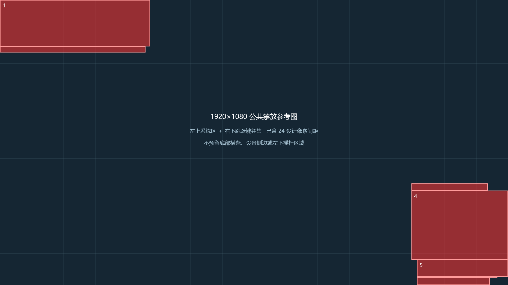

# 屏幕 UI 统一禁放区采样与验收

本页采样和运行证据属于公共禁放参考及迁移前 HUD。新增物种、装备、孵化和确认界面的证据见[个人农场阶段验收记录](个人农场阶段验收记录.md)，不以本页历史截图推定新增界面已通过。

日期：2026-11-10。项目：开发者鸡，PlaceId 134743372234687。

## 使用方式

Studio Edit 的 `ReplicatedStorage.UI.ScreenLayoutGuideFrame` 是唯一公共设计参考，固定 1920×1080。设计界面时临时复制到业务画布下，对齐左上角原点，不添加 UIScale；普通文字、按钮和关键内容避开红区。完成设计后移除业务模板中的参考副本，运行时不加载参考层。

业务根画布固定 1920×1080，AnchorPoint/Position 均为 (0.5,0.5)，UIScale 使用 min(屏幕宽/1920,屏幕高/1080)。UIAdapter 注册 Center 模式；不同宽高比保持居中、只缩放。屏幕容器 ScreenInsets=None，模态遮罩独立铺满实际视口。

公共禁放图已包括 24 设计像素间距。按最新要求只纳入左上系统区和原生跳跃按钮，不预留底部横条、设备侧边、右上系统区或左下摇杆。右侧形状是各端跳跃键矩形的精确并集，未使用右侧整片包围区。原始设备边缘数据继续留档，但 includedInGuide=false、paddedDesignRect=null，不参与合并。

## 采样来源与坐标

本次是 Studio 运行客户端设备模拟，不是物理真机。共 14 个设备/方向样本：桌面四档分辨率、iPhone 6 Plus、Samsung Galaxy A06、iPhone 13、iPad 第6代、Samsung Galaxy Tab A8，手机和平板各含两个横屏方向。仅涵盖这些已测横屏状态，不声明覆盖主机/VR/竖屏或未来系统 UI 变化。

数据由客户端插件上下文读取 GuiService:GetInsetArea(None/DeviceSafeInsets/TopbarSafeInsets)、业务根 AbsolutePosition/UIScale 与原生 JumpButton。顶栏左右占用边界使用引擎返回的顶栏空闲矩形反推，包含系统按钮预留空间；设备安全边缘采用引擎安全矩形，未逐个拟合圆角轮廓。跳跃键检查完整祖先显隐链。聊天窗口在采样截图中保持收起，展开聊天、菜单、软键盘不计入永久区域。各样本均成功读到安全区，移动设备均读到有效跳跃键，无需手工补画未知边界。

统一坐标 shift=-GetInsetArea(None).Min；所有矩形和根原点先加 shift，再用 (屏幕坐标-根原点)/根缩放换算。先与画布求交，完全在画布外及零面积区域排除；再扩 24 设计像素，向外取整、裁回画布。保留并集的分离区域及空洞，不做大包围盒。

实际渲染尺寸可能比预设少 1～2 像素，下面和原始 JSON 均记录实际值。数值原点使用统一屏幕坐标。

| 样本 | 实际屏幕 | 根原点 | 根缩放 | 跳跃键状态 | 证据 |
|---|---:|---:|---:|---|---|
| desktop-1080 | 1920×1079 | (0.889, 0.000) | 0.999074 | hidden | [截图](../Tools/UI/Samples/screenshots/desktop-1080.png) |
| desktop-720 | 1280×719 | (0.889, 0.000) | 0.665741 | hidden | [截图](../Tools/UI/Samples/screenshots/desktop-720.png) |
| desktop-1440 | 2560×1439 | (0.889, 0.000) | 1.332407 | hidden | [截图](../Tools/UI/Samples/screenshots/desktop-1440.png) |
| desktop-ultrawide | 2560×1078 | (321.778, 0.000) | 0.998148 | hidden | [截图](../Tools/UI/Samples/screenshots/desktop-ultrawide.png) |
| iphone_6_Plus-LandscapeLeft | 735×413 | (0.389, 0.000) | 0.382407 | visible | [截图](../Tools/UI/Samples/screenshots/iphone_6_Plus-LandscapeLeft.png) |
| iphone_6_Plus-LandscapeRight | 735×413 | (0.389, 0.000) | 0.382407 | visible | [截图](../Tools/UI/Samples/screenshots/iphone_6_Plus-LandscapeRight.png) |
| samsung_galaxy_a06-LandscapeLeft | 799×359 | (80.389, 0.000) | 0.332407 | visible | [截图](../Tools/UI/Samples/screenshots/samsung_galaxy_a06-LandscapeLeft.png) |
| samsung_galaxy_a06-LandscapeRight | 799×359 | (80.389, 0.000) | 0.332407 | visible | [截图](../Tools/UI/Samples/screenshots/samsung_galaxy_a06-LandscapeRight.png) |
| iphone_13-LandscapeLeft | 843×389 | (75.722, 0.000) | 0.360185 | visible | [截图](../Tools/UI/Samples/screenshots/iphone_13-LandscapeLeft.png) |
| iphone_13-LandscapeRight | 843×389 | (75.722, 0.000) | 0.360185 | visible | [截图](../Tools/UI/Samples/screenshots/iphone_13-LandscapeRight.png) |
| ipad_6th_generation-LandscapeLeft | 1023×767 | (0.000, 95.781) | 0.532812 | visible | [截图](../Tools/UI/Samples/screenshots/ipad_6th_generation-LandscapeLeft.png) |
| ipad_6th_generation-LandscapeRight | 1023×767 | (0.000, 95.781) | 0.532812 | visible | [截图](../Tools/UI/Samples/screenshots/ipad_6th_generation-LandscapeRight.png) |
| samsung_galaxy_tab_a8-LandscapeLeft | 959×599 | (0.000, 29.781) | 0.499479 | visible | [截图](../Tools/UI/Samples/screenshots/samsung_galaxy_tab_a8-LandscapeLeft.png) |
| samsung_galaxy_tab_a8-LandscapeRight | 959×599 | (0.000, 29.781) | 0.499479 | visible | [截图](../Tools/UI/Samples/screenshots/samsung_galaxy_tab_a8-LandscapeRight.png) |

原始数据、投影和扩边矩形见 [screen-layout-samples.json](../Tools/UI/Samples/screen-layout-samples.json)。Studio 原生视口截图不含 CoreGui，因此采样时补充窗口截图记录顶部系统按钮；历史版本的 [iPad 参考覆盖截图](../Tools/UI/Samples/screenshots/overlay-ipad_6th_generation.jpg) 使用 Studio MCP 截图，包含项目 UI、调整前的参考层、原生跳跃键，不包含顶部 CoreGui；该图保留旧底部横条，仅作为首次运行验收历史记录，最新参考以本页 PNG、JSON 和 RBXM 为准。

## 合并产物

14 个样本的有效扩边矩形共 21 条，完整覆盖验证通过，合并为 7 个互不重叠的矩形，总面积 246847 设计像素平方。区域编号仅用于记录，业务不依赖数量或名称。

| 编号 | 左上角 | 尺寸 |
|---|---:|---:|
| 1 | (0, 0) | 567×176 |
| 2 | (0, 176) | 550×23 |
| 3 | (1555, 695) | 289×27 |
| 4 | (1555, 722) | 365×262 |
| 5 | (1576, 984) | 344×65 |
| 6 | (1576, 1049) | 304×3 |
| 7 | (1576, 1052) | 275×28 |

- [公共模板 RBXM](../Assets/Studio/ScreenLayoutGuideFrame.rbxm)
- [更新后的完整 UI 模板包](../Assets/Studio/FarmUITemplates.rbxm)
- [修改前备份](../Assets/Studio/FarmUITemplates.before-screen-guide.rbxm)
- [合并矩形 JSON](../Tools/UI/Samples/screen-layout-union.json)、[SVG](../Tools/UI/Samples/screen-layout-guide.svg)

现有 HUD 的 ActionsFrame 固定在设计坐标 (960,968)、AnchorPoint=(0.5,1)，本次仅调整参考区域，其余业务布局保留模板位置。旧区域节点、区域 Attributes、UiRegions 模块及动态 RefreshLayout 已清理。GameFrame 模板修正为居中，GameFrameWrapper 注册 Center 模式。

## 验收记录

首次运行验收记录如下。本次区域收缩复用已有 14 个原始样本，重新生成并验证 21 条入选扩边矩形的覆盖；未重启 Play。

- 静态：HUD、GameFrameWrapper、客户端回归、采样器及两个 skill Luau 资产，共 6 个文件，luau-lsp 严格类型检查 0 Error。
- 离线：4 个几何单元测试通过，覆盖非零原点缩放投影、画布外/零面积裁剪、分离区域、顶部空闲通道和内部空洞；14 个样本的固定尺寸、缩放、居中原点、遮罩尺寸和 21 条扩边矩形完整覆盖断言通过。
- 模板：参考图 7 个真实预置 Frame、Active=false；业务模板无临时参考副本和旧区域节点。公共构建器在 Edit 的临时 Folder 中执行两次无重复，非法矩形拒绝后保留原模板。
- 运行：桌面、iPhone 13、iPad 第6代执行 FarmClientRegression，固定画布、居中缩放、参考隔离、全屏遮罩、重复初始化和幂等销毁全部通过。桌面720p、iPhone6 Plus、iPhone13 的业务控件与参考图相交检查为空；iPad 覆盖图核对操作条位于红区外。
- 同步：HUD 与 GameFrameWrapper 本地文件和 Studio 编辑器源码已核对，InstanceFileSyncService 状态 SyncedAsDescendant；旧 UiRegions 模块删除已同步。编辑器草稿与 Source 属性可能不同，不以旧 Source 属性作为同步结论，未通过 MCP 覆写源码、未提交草稿。
- 收尾：临时参考克隆销毁，Play 已停止，Edit 设备模拟恢复为 isSimulating=false、activeDeviceId=default。没有执行业务动作测试、提交/推送或发布 Package。

## 后续补采样

1. 在已授权的 Studio 客户端测试中切换到目标设备，等待布局稳定，用 `Tools/UI/ReadScreenLayoutSample.luau` 只读采样并保存截图、设备标签和方向。
2. 向 Samples/screen-layout-samples.json 添加样本。运行 `python Tools/UI/build_screen_layout_guide.py`，再运行 `python -m unittest discover -s Tools/UI -p "test_*.py"`。
3. 使用 skill 的 Edit 构建资产将合并 rectangles 更新到公共 Frame；复核受影响 UI，再重新导出 RBXM。参考图和采样工具不进入业务运行时。
